# Typing Animation

**A little motion. A little rhythm. Your own typing style.**

 **Client-only · Shareable presets · Custom sounds · Your own cursor**

Give Minecraft's text a little personality. Letters animate in and out, edits glide into place, and optional keyboard sounds give each keystroke a character — in chat, commands, search fields, **signs, hanging signs and books**. Settled text keeps its vanilla appearance.

**Fabric · Forge · NeoForge · English & Russian · No Fabric API required**

<p align="center" style="text-align: center">
<a href="https://modrinth.com/mod/typing-animation"></a>
&nbsp;&nbsp;
<a href="https://www.curseforge.com/minecraft/mc-mods/typing-animation"></a>
&nbsp;&nbsp;
<a href="https://github.com/AlexFirst404/typing-animation"></a>
</p>

<p align="center" style="text-align: center">
<a href="https://modrinth.com/mod/typing-animation">Modrinth</a> · <a href="https://www.curseforge.com/minecraft/mc-mods/typing-animation">CurseForge</a> · <a href="https://github.com/AlexFirst404/typing-animation">GitHub — source code</a>
</p>

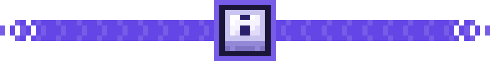

## ▸ Type. Edit. Enjoy.

Insert a word, erase a sentence or paste a message. Text shifts smoothly, while pasted text and autocomplete unfold letter by letter.

**Optional adaptive typing** follows your pace: faster keystrokes use shorter animations and gentler sound feedback. Slow typing keeps the full effect. Enable it when you want it; pasting stays one bulk edit.

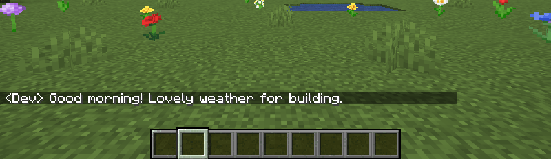

## ✦ Find your favourite motion

| Appearance | Removal | Timing |
|:---:|:---:|:---:|
| **17 effects** + Off | **10 effects** + Off | **10 easing curves** + Auto |
| Pop, Wave, Scramble, Flip, Swing, Roll, Spiral and more | Fade, Fall, Scatter, Spin, Squash and more | Separate duration and intensity; adjustable stagger and text glide |

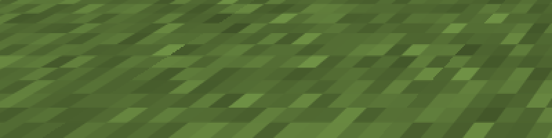

Try Slide Right, Zoom Out, Flip, Swing, Roll and Spiral, then pair them with your favourite removal effect.


### ✧ Pick a mood

Choose from **16 built-in visual presets**. Keep it simple with **Default · Minimal · Soft**, add character with **Bouncy · Wave · Glitch**, or try the ten new combinations in **1.5**:

| Crisp & familiar | Gentle & spacious | Playful & expressive |
|---|---|---|
| **Terminal · Typewriter · Snappy · Retro** | **Floating · Paper · Cinematic** | **Elastic · Swing · Orbit** |

Select a preset, press **Apply**, then fine-tune it in the live preview. Presets combine motion with a matching cursor, including its blinking and fade. Your sound settings, enabled fields and interface choices stay yours. **Typewriter** is a visual style; choose its sound separately in Sound. Manual visual edits appear as **Custom**.

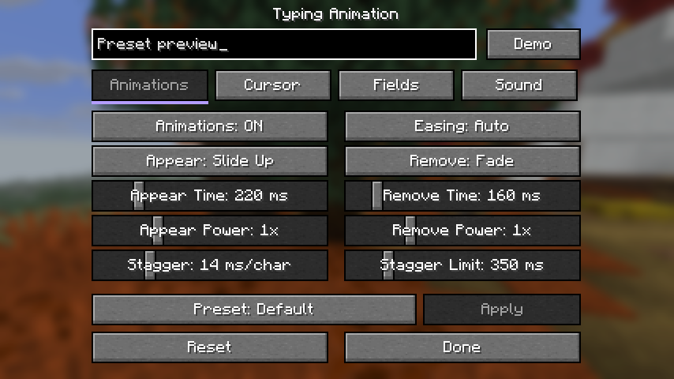

### ✧ Share your style · new in 1.3

Save your own combination of **animation, cursor and sound** under a name. Apply, duplicate or rename it, then **export a JSON preset** to share with friends. Importing a matching name creates a separate copy. Your enabled fields and interface preferences stay yours.

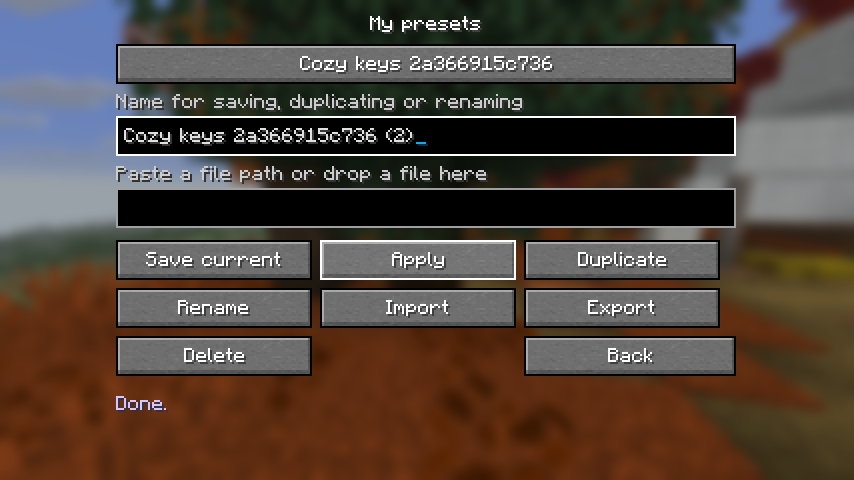

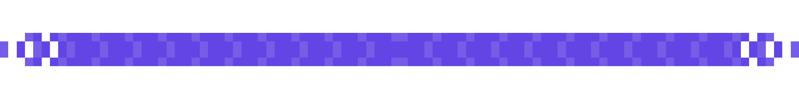

## ♪ Hear every keystroke

| Typewriter | Mechanical | Soft | Laptop |
|:---:|:---:|:---:|:---:|
| A crisp, vintage clack | A tactile keyboard click | A gentle, muted tap | A short, light tick |

Four sound families with distinct key, space, Backspace and Enter feedback. Adjust **volume, pitch and pitch variation**, mute deletion or Enter separately, and use **Test Sound** to listen before enabling.

**New in 1.3:** bring your own **Ogg Vorbis sound pack**. Drop a ZIP into **Sound packs**, import it, audition it and press **Use**. Switch between installed packs without another resource reload. [Sound pack format](https://github.com/AlexFirst404/typing-animation/blob/master/docs/custom-sound-packs.md). Presets refer to the selected pack; share its ZIP alongside the preset when it uses custom audio.

 **Sounds are off by default**; your existing sound settings carry over. Enable them in the **Sound** tab. Pasting makes at most one sound; cursor navigation and automatic field updates stay quiet.

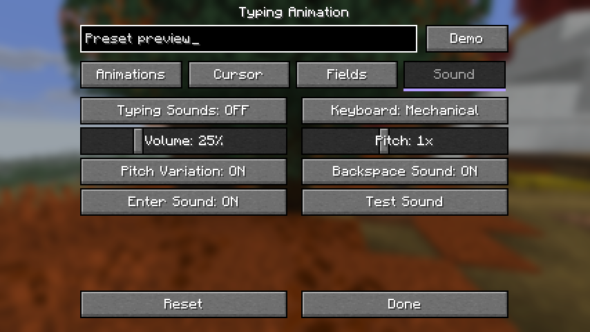

## │ A cursor that follows you

Smooth horizontal **and vertical** movement, with its own speed setting. Keep the vanilla cursor or choose a **bar, underline or translucent block**; pick a colour and thickness to match your style.

**New in 1.3:** enter your own **HEX colour**, adjust the blink period, choose a soft fade, or keep the caret visible while typing. Find the fine controls in **Detailed** mode.


## ▣ Leave a sign

Animations and optional typing sounds work while editing **ordinary and hanging signs**, across all four lines. Text colours, glowing text and normal editing controls stay intact.

### ▥ Write a book · new in 1.4

Book pages animate while you type and erase, with a smooth cursor. Turning a page displays its contents immediately. **Scholar** has an optional integration for its two-page editor and signing fields, preserving colours, formatting and alignment. Control page effects with **Fields → Multi-line Fields**; Scholar is not required.

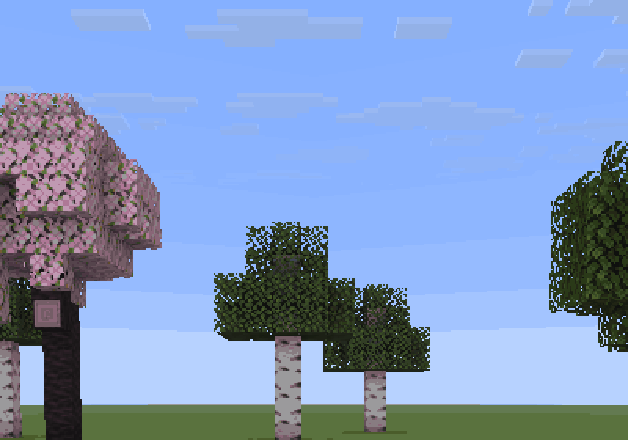

##  Make it yours

Choose **Basic** or **Detailed** on your first settings visit, then switch modes whenever you like. Basic keeps the essentials close; Detailed exposes timing, intensity, blink and sound controls across compact pages. Switching modes keeps your saved values.

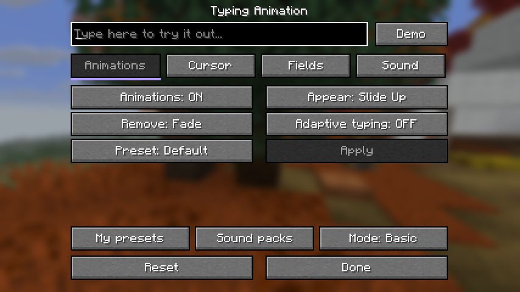

Four settings tabs: **Animations · Cursor · Fields · Sound**, with a **live preview** and **Demo** to try your changes.

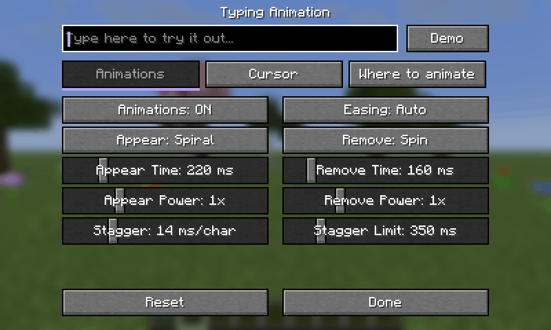

Open **Options → Typing Animation…**, the **Config** button in Forge/NeoForge's mod list, or **Mod Menu** on Fabric. Individual controls apply immediately; a visual preset uses **Apply**. Settings are saved in `config/typinganimation.json`.

**New in 1.5:** **Fields → Show Button In Game** hides the entry in Options opened from the pause menu, while keeping the main-menu entry. This separate switch works without Mod Menu. To hide the button globally, use the separate Options-button switch with Forge/NeoForge's built-in mods list or Mod Menu on Fabric/Quilt.

## / Commands keep their colours

Syntax highlighting stays intact while typing and completing commands with **Tab**.

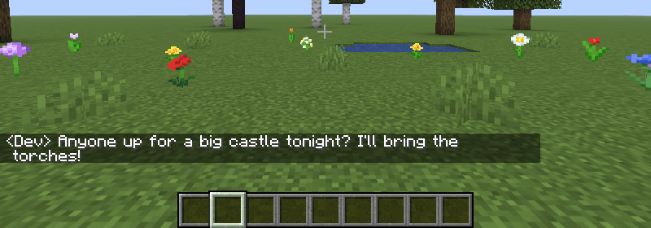

### ▸ More command editors · new in 1.5

Animations, smooth caret motion and optional keyboard sounds now work in **CommandBlockUIOverhaul** on Forge 1.20.1 / NeoForge 1.21.1 and **Better Command Block UI** on Fabric/Quilt. Keep their command colours, indentation, selection and scrolling. Enable **Fields → Multi-line Fields**; neither editor is required. Install each editor's own dependencies when using it, including matching Fabric API for Better Command Block UI on 26.3.

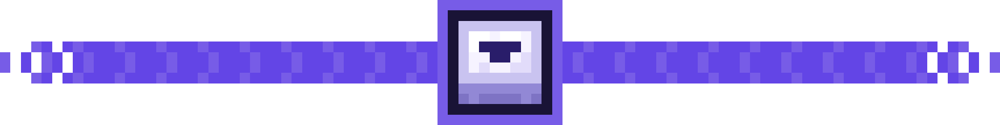

### Install & recommended companion

 Download the JAR for your **Minecraft version and loader**, then put it in `mods`. Install on your client; the server does not need the mod. **Fabric API is not required.**

 **Recommended for Fabric/Quilt: Mod Menu** — opens the settings directly from your mod list. It is an **optional dependency**: [Modrinth](https://modrinth.com/mod/modmenu) · [CurseForge](https://www.curseforge.com/minecraft/mc-mods/modmenu).

**Minecraft:** 1.20–1.20.1 · 1.21–1.21.1 · 1.21.4 · 1.21.5 · 1.21.6–1.21.8 · 1.21.9–1.21.10 · 1.21.11 · 26.1–26.1.2 · 26.2 · 26.3.

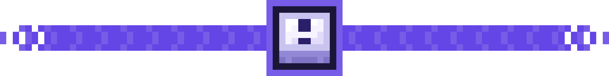

### Compatibility notes

Use the Forge file on NeoForge 1.20.1. Quilt support is limited to the Fabric files specifically tagged Quilt. **Minecraft 26.3 requires Quilt Loader 0.30.2 or newer.** Editable books are supported throughout the Minecraft versions listed above. Install a matching Scholar version if you want its redesigned editor. Mods replacing the standard text renderer may conflict.

**Made by AlexFirst** · [Source code on GitHub](https://github.com/AlexFirst404/typing-animation) · **MIT** · Modpacks welcome.

### 🇷🇺 Коротко на русском

Плавный набор в чате, командах, поиске и **обычных и подвесных табличках**. **17 эффектов появления, 10 эффектов удаления**, отдельные длительность и интенсивность, 10 кривых плавности и «Авто».

**Новое в 1.3:** сохраняйте собственные пресеты анимации, курсора и звука, копируйте, переименовывайте и делитесь ими через **импорт и экспорт JSON**. Свои звуковые наборы в **ZIP с Ogg Vorbis** можно импортировать и прослушать в библиотеке. JSON или ZIP можно перетащить в её окно.

**Новое в 1.4:** анимации страниц книг на всех поддерживаемых версиях и необязательная совместимость со **Scholar**, включая две страницы и поля подписи. Цвета, форматирование и переносы сохраняются. Перелистывание не запускает эффекты печати; страницы управляются пунктом **«Поля → Многострочные поля»**.

**Адаптация к скорости печати** ускоряет анимации и приглушает звук при быстром наборе. Включается отдельно. Курсору можно задать **HEX-цвет, период и плавность мигания**, постоянную видимость при наборе, форму, толщину и плавность движения по двум осям.

При первом входе выберите **«Базовый»** или **«Подробный»** интерфейс; режим можно поменять позже без сброса настроек. Четыре вкладки, живой предпросмотр и **«Демо»** помогают подобрать свой стиль.

**Новое в 1.5:** **«Поля → Кнопка в игре»** скрывает вход в настройках из меню паузы, сохраняя вход из главного меню. Mod Menu для этого не нужен. Для общего скрытия кнопки используйте отдельный переключатель и встроенный список модов Forge/NeoForge либо Mod Menu на Fabric/Quilt.

Добавлена необязательная совместимость с **CommandBlockUIOverhaul** на Forge 1.20.1 / NeoForge 1.21.1 и **Better Command Block UI** на Fabric/Quilt. Анимации, плавный курсор и звук сохраняют родную подсветку, выделение и прокрутку. Включаются через **«Поля → Многострочные поля»**. Зависимости самих редакторов устанавливаются отдельно; Better Command Block UI для 26.3 нужен подходящий Fabric API.

**16 готовых визуальных наборов** применяются кнопкой **«Применить»**. В **1.5** добавлены **Терминал · Машинка · Быстрый · Парящий · Упругий · Ретро · Маятник · Орбита · Бумажный · Кино**. Каждый сочетает движение текста с оформлением и миганием курсора. Ваши звуки, выбранные поля и настройки интерфейса сохраняются; для «Машинки» звук выбирается отдельно.

Четыре встроенных звуковых профиля: **печатная машинка, механическая клавиатура, мягкий звук и ноутбук**. **Звук изначально выключен**; включается во вкладке «Звук». Для пресета с собственным звуком передайте другу и JSON, и ZIP-набор.

**Настройки → Анимация ввода…**. Для Fabric/Quilt рекомендуем **Mod Menu** по ссылкам выше; зависимость необязательная. **Для Minecraft 26.3 нужен Quilt Loader 0.30.2 или новее.** Мод только клиентский, Fabric API не нужен. Цвета команд сохраняются. Автор — **AlexFirst**.

---

## Build & contribute

**1.5.0** adds 16 built-in presets, a separate in-game settings-button switch and optional command-editor adapters. See [release notes](docs/changelog-1.5.0.md), [release validation](docs/validation-1.5.0.md) and the [popular-mod compatibility survey](docs/compatibility-audit-2026-11-13.md). The survey distinguishes source inspection from runtime tests.

Each `targets/<Minecraft>-<loader>/` directory is an independent Gradle project. Shared animation code lives in `core/`, Minecraft integrations in `mc/<version>/`, and translations and the pixel logo in `common-resources/`.

Install JDK **17, 21 and 25**. Build scripts discover them automatically; use `JDK17_HOME`, `JDK21_HOME` and `JDK25_HOME` for custom locations. Gradle runs on JDK 21 for Forge/NeoForge and JDK 25 for Fabric; toolchains select the compilation version.

```bash
bash scripts/build-all.sh
# Windows without Bash:
powershell -ExecutionPolicy Bypass -File scripts/build-all.ps1

# One target / an actual in-game test:
bash scripts/run-target.sh 26.3-neoforge build
bash scripts/run-target.sh 26.3-neoforge selftest
```

Release JARs are collected in `dist/`. Always use `--no-daemon` for direct Gradle commands. The standalone `core` Gradle project contains the JUnit tests.

In-game self-tests exercise mixin application, typing, deletion, selections, scrolling, animation styles, both sign editors, actual book editing/signing screens and all settings tabs. When Scholar is installed, they also exercise its real text boxes and page-assignment method. They check sound input gates, visual-preset isolation, sound audition, first-visit interface modes, named preset menu actions and imported sound pack resources. They compare settled text against vanilla pixels, save screenshots, report `SELFTEST PASS` or `SELFTEST FAIL`, then close the client.

```bash
# Record actual Minecraft UI and build GIFs/screenshots:
bash scripts/make-gallery.sh
# Regenerate the two identical platform descriptions and this README:
node scripts/sync-description.mjs
node scripts/sync-description.mjs --check
# Validate release kits without uploading:
node scripts/modrinth-publish.mjs
node scripts/curseforge-publish.mjs
```

The media recorder creates a disposable showcase world and saves frames in the system temporary directory. `tools/MakeGif.java` produces the GIFs in `modrinth/gallery/`. The same media are used on all three platforms.

The 36 original keyboard samples are generated by `scripts/generate-typing-sounds.py`; its `--check` mode verifies reproducibility without changing assets. The source lists the Python audio-library versions used. Sound resources and English/Russian subtitles are validated by the core tests.

**Documentation:** [Engineering spec](docs/SPEC.md) · [1.4 release notes](docs/changelog-1.4.0.md) · [1.4 release validation](docs/validation-1.4.0.md) · [Custom sound packs](docs/custom-sound-packs.md) · [Modrinth publishing](modrinth/README.md) · [CurseForge publishing](curseforge/README.md). Edit the shared public description in [`docs/project-description.md`](docs/project-description.md), then run the sync script. Publish credentials belong only in process environment variables, never in repository files.

**По-русски:** для сборки нужны JDK 17, 21 и 25; готовые JAR находятся в `dist/`. Команда `selftest` запускает проверку в настоящем клиенте Minecraft. Общее описание для Modrinth, CurseForge и GitHub редактируется в `docs/project-description.md` и переносится командой `node scripts/sync-description.mjs`.
